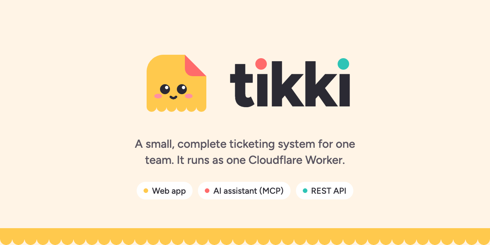

<picture>
  <source media="(prefers-color-scheme: dark)" srcset="docs/assets/readme-cover-dark.png">
  
</picture>

People raise a ticket in three ways:

- **The web app.** Choose a type, fill in its fields, and get a reference such as `BUG-12`.
- **An AI assistant.** Connect Claude, ChatGPT, Gemini CLI, GitHub Copilot, Cursor or any other MCP client. Write one sentence. The assistant selects the type, fills in the fields, and asks only for what is missing.
- **The REST API.** Other systems raise tickets for their customers and get signed webhooks back.

You own the code, the data and the server. On a small team, it can run on the Cloudflare Free plan.

## Why minimal, why complete

Most ticketing tools give you a large product and many settings. Tikki gives you one ticket model and the few features that make it work from start to end. Each feature has a reason to exist. Each missing feature has a reason to wait.

### Complete: the full life of a ticket

| Step | What Tikki does |
|---|---|
| Raise | Web form, AI assistant (MCP), or REST API. All three use the same code and the same rules. |
| Describe | Admins make Ticket Types (Bug, Data request, Payment issue, ...) with their own fields, help text and prefix. When you change a type, it gets a new version. Old tickets keep their version. |
| Route | Each type has an owning Team. Agents can move a ticket to another Team and assign it to any Agent. |
| Work | One list, grouped by Status. Public comments for the requester, internal comments for the team. Status, priority, type and assignee changes. |
| Undo | Every change goes into the Activity. An Agent can reverse a change from there. |
| Protect | Tickets of a "Participants only" type are visible only to the people on the ticket and to Admins. Requesters never see internal comments. |
| Attach | Files up to 25 MB in R2. The AI assistant can attach text, or give the user an upload link. |
| Notify | An in-app Inbox for every user. Email when it is configured. |
| Integrate | Signed webhooks (Standard Webhooks) with the ticket `before` and `after`, delivered at least once. Each Application gets only the Events for its own tickets. |
| Audit | One audit log for ticket changes and admin changes. Each entry shows who made the change (a user or an Application) and the channel (web, AI or API). |
| Erase | Admins can hide a ticket and restore it. Erasing a Contact removes the Contact's personal data from tickets, comments and the audit log. |

### Minimal: the decisions that keep it small

- **One Worker.** It serves the web app, the API, OAuth and MCP. There are no servers, no containers and no queues to run.
- **One database.** D1 (SQLite) holds everything. Webhooks use an outbox table and a one-minute Cron Trigger, not a queue service.
- **One access rule.** One function decides who can read a ticket. The web app, the API, the AI assistants and webhooks all use it. So a ticket cannot be private in one channel and visible in another.
- **One write path.** Every ticket change saves the change, the audit entry, the Event and the notifications together. A change cannot be saved without its record.
- **No passwords.** Users sign in with a one-time code sent to their work email. An allow list of email domains and invites control who can sign in.
- **No in-app AI.** Each user brings their own AI assistant and connects it through MCP. Tikki itself calls no model and adds no model cost.
- **Fail visibly.** A wrong setting stops the Worker at startup with a clear error.

### Not included, on purpose

Custom workflows and statuses, SLAs, automations, reports, watchers and mentions, Kanban and calendar views, direct messages, multi-tenancy, full-text search and in-app LLM features.

Kanban is the first view to add. Status changes already go through one API, so it is only a UI addition.

## Use it from an AI assistant

Tikki is a remote MCP server at `https://<your-domain>/mcp`. It uses the MCP standard sign-in (OAuth 2.1 with dynamic client registration or client ID metadata documents). So most MCP clients connect without an API key: the client opens a sign-in window, the user signs in with their work email and approves access.

| Assistant | How to connect |
|---|---|
| Claude (web and desktop) | Settings, Connectors, add a custom connector with the MCP URL. |
| Claude Code | `claude mcp add --transport http tikki https://<your-domain>/mcp` |
| ChatGPT | Turn on developer mode, then add a connector (app) with the MCP URL and OAuth. Availability depends on your plan. |
| Gemini CLI | In `settings.json`: `"mcpServers": { "tikki": { "httpUrl": "https://<your-domain>/mcp" } }` |
| GitHub Copilot in VS Code | In `.vscode/mcp.json`: `"servers": { "tikki": { "type": "http", "url": "https://<your-domain>/mcp" } }` |
| Cursor | In `~/.cursor/mcp.json`: `"mcpServers": { "tikki": { "url": "https://<your-domain>/mcp" } }` |
| Other MCP clients | Add a remote server (Streamable HTTP) with the MCP URL. |

Menus and file formats change often. If a step is different, look in the documentation of your assistant for "remote MCP server". Tikki is tested with Claude. The other clients use the same standard.

Then ask, for example: "The checkout page shows a blank screen on Safari."

The assistant can list and get Ticket Types, create, search and read tickets, add comments and text attachments, and request an upload link. Agents can also change status, priority, type, assignee and Team. The assistant acts as the signed-in user, with that user's permissions. A web-based assistant (claude.ai, ChatGPT) must reach your server on the internet; a local client (Claude Code, Cursor, VS Code) can also use `http://localhost:8787/mcp`.

## Use it from another system

Admins create an **Application** and give it an API key, permissions and the Ticket Types it can use. The Application raises tickets for its **Contacts** (its own customers). Contacts do not need an account.

The API is described in OpenAPI at `/api/v1/openapi.json`. Each Application has its own rate limit.

## Stack

| Part | Choice |
|---|---|
| Runtime | Cloudflare Workers |
| Web app | Nuxt 4 (SPA), Nuxt UI, Tailwind CSS 4 |
| Sign-in and OAuth | Better-Auth (email code, OAuth 2.1 server for MCP) |
| Database | Cloudflare D1 with Drizzle ORM |
| Files | Cloudflare R2, private, served only through the Worker |
| Email | Cloudflare Email Sending |
| AI | Model Context Protocol (MCP), stateless HTTP |

## Run it locally

You need Node 22.13 or later and pnpm 10.

```bash
pnpm install
```

```bash
cp .dev.vars.example .dev.vars
```

Put a secret in `.dev.vars`. To make one:

```bash
openssl rand -base64 32
```

Apply the migrations:

```bash
pnpm db:migrate:local
```

Start the Worker:

```bash
pnpm dev
```

Open http://localhost:8787. Sign in with an address at `example.com`. The sign-in code shows in the terminal output. `admin@example.com` becomes the Admin at its first sign-in.

To connect a local MCP client, use `http://localhost:8787/mcp`. Web-based assistants cannot reach localhost. Use a deployed copy for them.

## Configuration

| Variable | Required | Meaning |
|---|---|---|
| `APP_ENV` | yes | `development`, `test`, `staging` or `production` |
| `APP_URL` | yes | The origin, for example `https://tickets.example.com` |
| `BETTER_AUTH_SECRET` | yes (secret) | At least 32 characters |
| `ALLOWED_EMAIL_DOMAINS` | yes | Comma-separated email domains that can sign in. Subdomains do not match |
| `MAIL_TRANSPORT` | yes | `cloudflare`. `console` is for development only |
| `MAIL_FROM` | with `cloudflare` | The sender address, on a domain set up for Cloudflare Email Sending |
| `ADMIN_EMAIL` | no | The first sign-in with this address becomes Admin. It has no effect after an Admin exists |

Bindings: `DB` (D1), `FILES` (R2), `EMAIL` (`send_email`), `ASSETS`.

## Tests

```bash
pnpm typecheck
```

```bash
pnpm test
```

This checks the migrations, builds the Worker, and runs the tests in the Workers runtime with a local D1. The tests use only HTTP, as a real client does: sign-in, the full OAuth flow, an MCP client, the REST API and webhooks.

```bash
pnpm e2e
```

This runs the Playwright browser tests. They include a layout check at phone and desktop widths, in light and dark mode.

## Project status

The product is complete for local use. These parts are not done yet:

- Deploys to staging and production.
- Nightly backups to R2.
- Sign-in with Google, Microsoft or OIDC.
- A "Deploy to Cloudflare" button and self-hosting guide.

## For contributors

| Read | When |
|---|---|
| [CONTEXT.md](CONTEXT.md) | You need the exact meaning of a term (Ticket Type, Participant, Contact, ...) |
| [docs/DECISIONS.md](docs/DECISIONS.md) | You want to know why a rule exists |
| [docs/architecture.md](docs/architecture.md) | You change `server/`: the main code paths and the one function to call for each |
| [docs/agents/parallel-work.md](docs/agents/parallel-work.md) | You write a migration |
| [CODING_STANDARDS.md](CODING_STANDARDS.md) | You review a change |

## License

MIT
